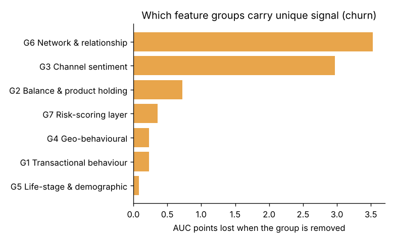

# Retail Churn Feature Store: 48 Features, 7 Groups, Validated

A single, validated churn feature layer for retail banking. It provides **48 features in 7 behavioural groups**, built from **six source tables joined through the account master** over a **12-month observation window**, with a graded target structure and a validation suite (grain, join integrity, null and range checks, PSI drift).

> **About the data.** This is a public re-implementation of a feature store I designed and built at a commercial bank. Source data is proprietary and is **not** in this repo. The code runs on six synthetic tables with the same structure. The "In production" section describes the real project. Results after it come from the synthetic data.



## In production (the real project, Jul–Aug 2026)

| | |
|---|---|
| **Features** | **48 features**, **12-month observation window** |
| **Sources** | **Six Oracle source tables**, joined through the **account master** |
| **Architecture** | Seven groups: transactional behaviour, balance/product, **channel sentiment (via the CSS model)**, **geo-behavioural (via the Customer Residence Inference model)**, life-stage/demographic, network/relationship, risk-scoring layer |
| **Target** | Churn = **90+ days of dormancy**, with a **graded target structure**: binary flag + survival label + **45–60-day early warning** |
| **Validation** | Full SQL pipeline with validation queries. Dormancy outcomes in the historical data mart were confirmed as a usable labelled source |

This repo reproduces the seven-group architecture, the account-master join pattern, the graded targets and the validation layer.

## The seven groups

| Group | # | Examples |
|---|---|---|
| G1 Transactional | 10 | 3m-vs-9m trend, active months, longest inactive gap, months since peak |
| G2 Balance & product | 8 | balance trend (signed log), 3m vs 12m balance, product count, card / loan |
| G3 Channel sentiment | 6 | shrunk digital success rate, failed attempts, digital share, **CSS score** |
| G4 Geo-behavioural | 5 | states used, top-state share, **relocated vs account-opening state** |
| G5 Life-stage | 6 | age, tenure, new-to-bank, affluent, months since KYC update |
| G6 Network & relationship | 6 | **salary months**, months since salary, **share of outflow to own accounts elsewhere** |
| G7 Risk layer | 7 | rule flags (salary stopped, balance drain, txn drop, digital friction, funds leaving), early-warning points |

Full list: [`docs/feature_dictionary.md`](docs/feature_dictionary.md), generated from `src/registry.py`.

## Validation layer

| Check | What it catches | Result (synthetic) |
|---|---|---|
| **Grain** (`v1_grain_check.sql`) | Pseudo-replicated rows: one row per *account* instead of per *customer* | 9/9 ✓ |
| **Join integrity** (`v2_join_integrity.sql`) | Orphans silently dropped by inner joins | 4/4 ✓ |
| **Null & range** (generated from the registry) | Broken logic, unit errors, divide-by-zero | 48/48 ✓ |
| **PSI drift** between snapshots | Distribution shifts before a model degrades | 47 stable, 1 flagged |

The single drift flag (`g1_months_since_peak`) is **seasonality**: the December peak moves relative to the snapshot. This is the kind of thing the monitor exists to surface.

## Do the features carry signal? (synthetic reproduction)

XGBoost trained on the month-15 snapshot and tested on month 18:

| Target | Test rate | AUC (all 48) |
|---|---|---|
| 90-day dormancy | 1.9% | **0.779** |
| 45–60-day early warning | 2.3% | **0.766** |

**Unique signal by group** (AUC lost when the group is removed): Network & relationship **−3.5 pts**, Channel sentiment **−3.0 pts**. Every other group is below 1 point, meaning its information is largely shared with others.

**The rule layer alone ranks risk:** customers with 0 flags have a 1.3% dormancy rate, 1 flag 7.6%, and 2+ flags more than 50% (small n).

## Run it

```bash
pip install -r requirements.txt
python run_pipeline.py      # builds 2 snapshots, validates, writes docs/ and reports/
```

## Repo layout

```
data/generate_synthetic.py           six source tables
sql/00_population.sql
sql/features/g1..g7_*.sql            one file per feature group
sql/08_targets.sql                   graded targets
sql/validation/v1_grain_check.sql
sql/validation/v2_join_integrity.sql
src/registry.py                      48 features: group, description, expected range
src/feature_store.py                 build + validation + PSI + dictionary
docs/feature_dictionary.md
run_pipeline.py
notebooks/walkthrough.ipynb
```

## Author

**Oluwasemilore Sadare**, Senior Data Scientist · [LinkedIn](https://www.linkedin.com/in/oluwasemilore-sadare) · [GitHub](https://github.com/SMLRE)
